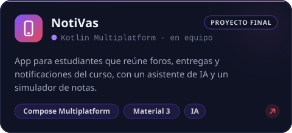
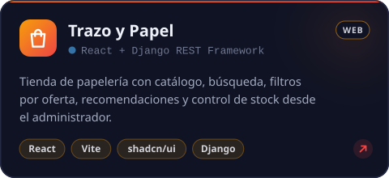
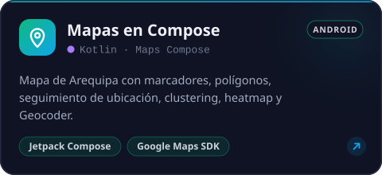
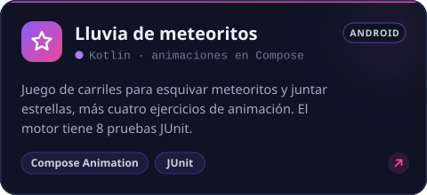
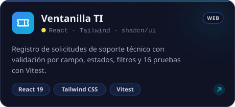
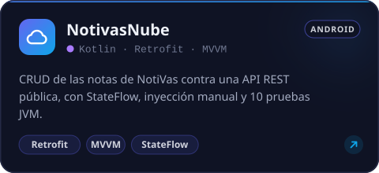

<picture>
  <source media="(prefers-color-scheme: dark)" srcset="assets/banner-dark.svg">
  <source media="(prefers-color-scheme: light)" srcset="assets/banner-light.svg">
  
</picture>

<p align="center">
  <a href="#sobre-mí"><b>Sobre mí</b></a> &nbsp;·&nbsp;
  <a href="#tecnologías"><b>Tecnologías</b></a> &nbsp;·&nbsp;
  <a href="#proyectos-destacados"><b>Proyectos</b></a> &nbsp;·&nbsp;
  <a href="#actividad"><b>Actividad</b></a>
</p>

## Sobre mí

Estudio Diseño y Desarrollo de Software en Tecsup, en Arequipa. Lo que más disfruto es hacer apps Android con Kotlin y Jetpack Compose, aunque en la carrera también he construido frontends con React, APIs con Django REST Framework y Spring Boot, y algunos prototipos IoT con ESP32.

Me gusta comprobar que las cosas funcionan de verdad: corro la app en el emulador o en el celular, escribo pruebas y dejo anotado lo que falla. Por eso muchos de mis repositorios traen un README con lo que encontré al probar y videos de demostración.

```kotlin
object Alejandro {
    val ubicacion = "Arequipa, Perú"
    val carrera   = "Diseño y Desarrollo de Software · Tecsup"
    val enfoque   = listOf("Android nativo", "Kotlin Multiplatform", "Web con React y Django")
    val ahora     = "Terminando NotiVas, el proyecto final del curso de móviles"
}
```

## Tecnologías

<table>
  <tr>
    <td width="150"><b>Móvil</b></td>
    <td>
      <picture>
        <source media="(prefers-color-scheme: light)" srcset="https://skillicons.dev/icons?i=kotlin%2Candroidstudio%2Cfirebase%2Cgradle&theme=light">
        
      </picture>
      <br><sub>Jetpack Compose · Kotlin Multiplatform · Room · Retrofit · Coil · Google Maps SDK</sub>
    </td>
  </tr>
  <tr>
    <td><b>Frontend</b></td>
    <td>
      <picture>
        <source media="(prefers-color-scheme: light)" srcset="https://skillicons.dev/icons?i=react%2Cvite%2Ctailwind%2Cjs%2Chtml%2Ccss%2Cbootstrap&theme=light">
        
      </picture>
      <br><sub>shadcn/ui · axios · Vitest · Testing Library</sub>
    </td>
  </tr>
  <tr>
    <td><b>Backend</b></td>
    <td>
      <picture>
        <source media="(prefers-color-scheme: light)" srcset="https://skillicons.dev/icons?i=python%2Cdjango%2Cjava%2Cspring%2Cgo%2Cnodejs%2Cexpress&theme=light">
        
      </picture>
      <br><sub>Django REST Framework · JWT · arquitectura hexagonal · microservicios</sub>
    </td>
  </tr>
  <tr>
    <td><b>Bases de datos</b></td>
    <td>
      <picture>
        <source media="(prefers-color-scheme: light)" srcset="https://skillicons.dev/icons?i=mysql%2Csqlite%2Cmongodb&theme=light">
        
      </picture>
      <br><sub>H2 · Room · Firestore</sub>
    </td>
  </tr>
  <tr>
    <td><b>DevOps y calidad</b></td>
    <td>
      <picture>
        <source media="(prefers-color-scheme: light)" srcset="https://skillicons.dev/icons?i=docker%2Cgit%2Cgithub%2Cgithubactions%2Cjenkins%2Caws%2Clinux%2Cnginx&theme=light">
        
      </picture>
      <br><sub>Docker Compose · JUnit · SonarQube</sub>
    </td>
  </tr>
  <tr>
    <td><b>IoT y diseño</b></td>
    <td>
      <picture>
        <source media="(prefers-color-scheme: light)" srcset="https://skillicons.dev/icons?i=arduino%2Cfigma&theme=light">
        
      </picture>
      <br><sub>ESP32 · MQTT · Node-RED · Wokwi · Tinkercad</sub>
    </td>
  </tr>
</table>

## Proyectos destacados

<p align="center">
  <a href="https://github.com/Joxquin/NotiVas-KMP"><picture>
    <source media="(prefers-color-scheme: dark)" srcset="assets/proyecto-notivas-dark.svg">
    <source media="(prefers-color-scheme: light)" srcset="assets/proyecto-notivas-light.svg">
    
  </picture></a>
  <a href="https://github.com/ALEDEROSEE/GLAB-S14-trazo-y-papel"><picture>
    <source media="(prefers-color-scheme: dark)" srcset="assets/proyecto-trazo-y-papel-dark.svg">
    <source media="(prefers-color-scheme: light)" srcset="assets/proyecto-trazo-y-papel-light.svg">
    
  </picture></a>
  <a href="https://github.com/ALEDEROSEE/GLAB-S12-GoogleMaps-Compose"><picture>
    <source media="(prefers-color-scheme: dark)" srcset="assets/proyecto-mapas-compose-dark.svg">
    <source media="(prefers-color-scheme: light)" srcset="assets/proyecto-mapas-compose-light.svg">
    
  </picture></a>
  <a href="https://github.com/ALEDEROSEE/GLAB-S13-Animaciones-Compose"><picture>
    <source media="(prefers-color-scheme: dark)" srcset="assets/proyecto-meteoritos-dark.svg">
    <source media="(prefers-color-scheme: light)" srcset="assets/proyecto-meteoritos-light.svg">
    
  </picture></a>
  <a href="https://github.com/ALEDEROSEE/GLAB-S11-ventanilla-ti"><picture>
    <source media="(prefers-color-scheme: dark)" srcset="assets/proyecto-ventanilla-ti-dark.svg">
    <source media="(prefers-color-scheme: light)" srcset="assets/proyecto-ventanilla-ti-light.svg">
    
  </picture></a>
  <a href="https://github.com/ALEDEROSEE/NotivasNube-RestfulApi"><picture>
    <source media="(prefers-color-scheme: dark)" srcset="assets/proyecto-notivas-nube-dark.svg">
    <source media="(prefers-color-scheme: light)" srcset="assets/proyecto-notivas-nube-light.svg">
    
  </picture></a>
</p>

<details>
<summary><b>Más proyectos</b></summary>
<br>

| Proyecto | Qué es | Tecnologías |
| --- | --- | --- |
| [Bookshelf](https://github.com/ALEDEROSEE/Bookshelf-OpenLibrary) | Cuadrícula de portadas de libros con datos de Open Library | Kotlin · Retrofit · Coil |
| [Make It So + Firebase](https://github.com/ALEDEROSEE/GLAB-S11-MakeItSo-Firebase) | Lista de tareas con inicio de sesión, Firestore, Crashlytics y Performance | Kotlin · Firebase |
| [MVVM + Room](https://github.com/ALEDEROSEE/Lab08-MVVM-Room) | App de tareas con arquitectura MVVM, flujo unidireccional y Room | Kotlin · Room |
| [Buscador de Star Wars](https://github.com/ALEDEROSEE/GLAB-S12-buscador-star-wars) | Búsqueda de personajes en tiempo real | React · axios · Bootstrap |
| [Gestor de productos](https://github.com/ALEDEROSEE/GLAB-S10-gestor-productos) | Gestión de productos con componentes de shadcn/ui | React · Vite · Tailwind |
| [Catálogo React + Django](https://github.com/ALEDEROSEE/GLAB-S10-lab10-react-django) | Catálogo web que consume una API de productos | React · Django REST Framework |
| ViaSmart | Semáforo inteligente con ESP32; mi aporte al equipo fueron las piezas impresas en 3D | ESP32 · impresión 3D |
| Taller mecánico | Registro de órdenes de servicio y boletas en PDF | Java · JasperReports |
| CRUD de usuarios, productos y empleados | Aplicación web con tres módulos | Node.js · Express · MongoDB |

</details>

## Actividad

<picture>
  <source media="(prefers-color-scheme: dark)" srcset="assets/stats-dark.svg">
  <source media="(prefers-color-scheme: light)" srcset="assets/stats-light.svg">
  
</picture>

<picture>
  <source media="(prefers-color-scheme: dark)" srcset="https://raw.githubusercontent.com/ALEDEROSEE/ALEDEROSEE/output/snake-dark.svg">
  <source media="(prefers-color-scheme: light)" srcset="https://raw.githubusercontent.com/ALEDEROSEE/ALEDEROSEE/output/snake-light.svg">
  
</picture>

<picture>
  <source media="(prefers-color-scheme: dark)" srcset="assets/pie-dark.svg">
  <source media="(prefers-color-scheme: light)" srcset="assets/pie-light.svg">
  
</picture>
